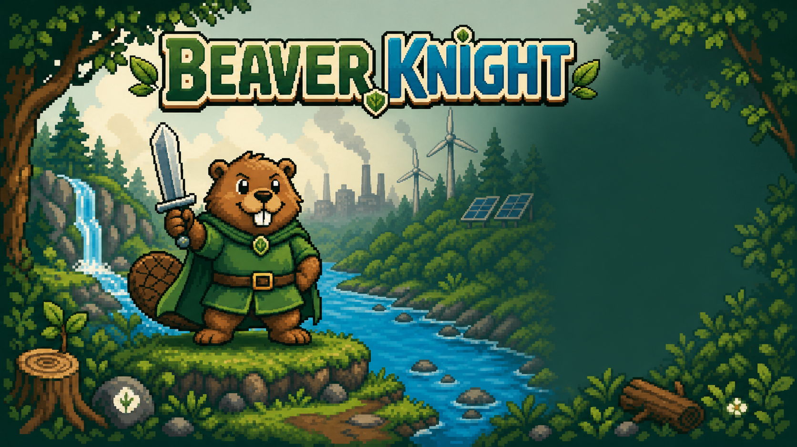

# 🦫⚔️ BeaverKnight — Sustentabilidade em 8-Bits

<p align="center">
  
</p>

<p align="center">
  <a href="https://novaes11.github.io/BeaverKnight/"></a>
  
  
  
</p>

> 🌐 **Acesse a Landing Page Oficial (GitHub Pages):** [**https://novaes11.github.io/BeaverKnight/**](https://novaes11.github.io/BeaverKnight/)

---

## 📖 Sobre o Projeto

O **BeaverKnight** é um jogo educativo 2D em estilo **Pixel Art** desenvolvido como **Projeto de Extensão Universitária** no curso de Ciência da Computação do **Centro Universitário Filadélfia (UniFil)**.

O objetivo central do projeto é gamificar a conscientização ambiental — abordando preservação de recursos hídricos, combate a derramamentos de petróleo, reflorestamento e transição para energias limpas — por meio de uma aventura top-down clássica na qual o jogador controla o **Cavaleiro Castor** na defesa do ecossistema.

---

## ⚙️ Arquitetura Técnica & Sistemas (Godot 4.6)

- **Resolução Nativa Pixel-Perfect**: `320×180 px` com upscale para `1280×720 px` (`snap_2d_transforms_to_pixel=true`).
- **Arquitetura de Mapa em Camadas (`Scene/town.tscn`)**:
  - `tipo_terreno`: Camada base de solo e corpos d'água com validação por `source_id` (`WALKABLE_TERRAIN_SOURCES`).
  - `caminho_terreno`: Estradas e pontes que liberam a travessia do jogador sobre rios e zonas bloqueadas.
  - `vegetação_layer` e `construções_layer`: Camadas de ambientação florestal, estruturas urbanas, tubulações e obstáculos físicos.
- **Movimentação Livre & Combate Direcional (`Scripts/Character/Player/player.gd`)**:
  - Deslocamento contínuo em 8 direções com deslizamento independente nos eixos X/Y nas margens dos rios.
  - Ataque armado com detecção híbrida: dano imediato em curta distância (`12px`) e cone frontal de ~140° (`dot > 0.3` até `28px`).
  - Máquina de estados de animação via `AnimationTree` (`idle`, `walk`, `attack_armed`).
- **IA de Inimigos, Knockback & Spawner (`Scripts/Character/Enemy/`)**:
  - Perseguição vetorial contínua (`inimigo.gd`), dissipação de impacto (*knockback*), protótipo de navegação em grade com `RayCast2D` (`enemy_movement.gd`) e geração controlada alinhada a `16px` (`enemy_spawn.gd`).
- **Engenharia Acústica 8-Bit (`Scripts/World/audio_manager.gd`)**:
  - Singleton Autoload (`AudioManager`) gerenciando 8 canais `AudioStreamPlayer` globais e 8 canais `AudioStreamPlayer2D` posicionais, roteados pelos barramentos de `Sounds/Bus_DeControle.tres` (`Master`, `Music`, `Effect`).

---

## 🎮 Como Jogar

| Comando | Ação no Jogo |
| :--- | :--- |
| **Setas Direcionais (`←` `↑` `↓` `→`) / D-Pad** | Movimentam o Cavaleiro Castor pelo mapa e pontes |
| **Botão Esquerdo do Mouse (`Clique`)** | Executa o ataque com espada contra os inimigos |

---

## 👥 Equipe de Desenvolvimento, Atribuições & Evidências no Repositório

| Integrante | Atribuições Principais | Evidências no Repositório / Código |
| :--- | :--- | :--- |
| **João Vitor Novaes** | Gestão de backlog e sprint no Notion; Level Design da cidade; configuração dos TileSets de terreno, canos, estruturas de mata e óleo; documentação e Landing Page. | Arquitetura de camadas em [`Scene/town.tscn`](beaver-knight-app/Scene/town.tscn), mapeamento de texturas em `Assets/Water` ([`DirtyWaterTexture.tres`](beaver-knight-app/Assets/Water/DirtyWaterTexture.tres)), organização de diretórios e documentações do projeto ([`docs/`](docs/)). |
| **Enzo Schmidt** | Engenharia acústica, curadoria de SFX (Pixabay/geradores 8-bit) e desenvolvimento do controlador geral de áudio. | [`Scripts/World/audio_manager.gd`](beaver-knight-app/Scripts/World/audio_manager.gd), configuração de barramentos em [`Sounds/Bus_DeControle.tres`](beaver-knight-app/Sounds/Bus_DeControle.tres) e roteamento de efeitos globais/posicionais 2D. |
| **João Camargo** | Design de interfaces (UI/UX) do menu principal e estruturação da física base de colisões do ambiente. | [`Scene/main_menu.tscn`](beaver-knight-app/Scene/main_menu.tscn), [`Scripts/UI/main_menu.gd`](beaver-knight-app/Scripts/UI/main_menu.gd), parametrização de nós de colisão e delineamento de máscaras nos TileMaps. |
| **Rafael Vasconcelos** | Ilustração e animação em Pixel Art dos personagens e elementos dinâmicos. | Spritesheets do castor ([`beaverSprite.png`](beaver-knight-app/Sprites/beaverSprite.png)), variações de caminhada/ataque, artes do Death Slime, capangas de petróleo ([`capanga_petroleopng.png`](beaver-knight-app/Sprites/capanga_petroleopng.png)) e efeitos de corte de espada ([`slash_128.png`](beaver-knight-app/Sprites/custom/slash_128.png)). |
| **João Tavares e Henrique Cavalari** | Engenharia de gameplay: implementação das físicas de movimentação do jogador, lógica de combate e IA dos inimigos. | [`Scripts/Character/Player/player.gd`](beaver-knight-app/Scripts/Character/Player/player.gd), [`Scripts/Character/Enemy/inimigo.gd`](beaver-knight-app/Scripts/Character/Enemy/inimigo.gd), rotinas de perseguição, knockback e protótipo de raycasting em [`enemy_movement.gd`](beaver-knight-app/Scripts/Character/Enemy/enemy_movement.gd). |

---

## 📂 Estrutura do Repositório

```text
BeaverKnight/
├── beaver-knight-app/               # Projeto principal na Godot Engine 4.6
│   ├── Assets/                      # TileSets, texturas de água (Water/DirtyWater), fontes e UI
│   ├── Scene/                       # Cenas (.tscn): main_menu, town, player, inimigo
│   ├── Scripts/                     # Lógica em GDScript (Player, Enemy, UI, World/AudioManager)
│   ├── Sounds/                      # Barramento Bus_DeControle.tres, SFX 8-bit e Soundtrack
│   ├── Sprites/                     # Spritesheets do Castor, Capanga de Petróleo e cortes de espada
│   └── project.godot                # Configuração do projeto Godot 4.6
└── docs/                            # Código-fonte da Landing Page (GitHub Pages)
    ├── assets/                      # Estilos CSS, scripts JS, fotos da equipe, vídeo e artes
    └── index.html                   # Página principal do projeto
```

---

## 🚀 Como Executar Localmente

1. **Para rodar o jogo (`beaver-knight-app`)**:
   - Instale a **Godot Engine 4.6** (ou superior compatível com Godot 4.x).
   - Abra o gerenciador de projetos da Godot, clique em **Importar** e selecione o arquivo `beaver-knight-app/project.godot`.
   - Pressione `F5` para iniciar a partir da cena principal (`Scene/main_menu.tscn`).
2. **Para visualizar a Landing Page (`docs/`)**:
   - Sirva o diretório `docs/` com qualquer servidor HTTP estático (ex.: `python3 -m http.server 8000 --directory docs`) e acesse `http://localhost:8000`.
