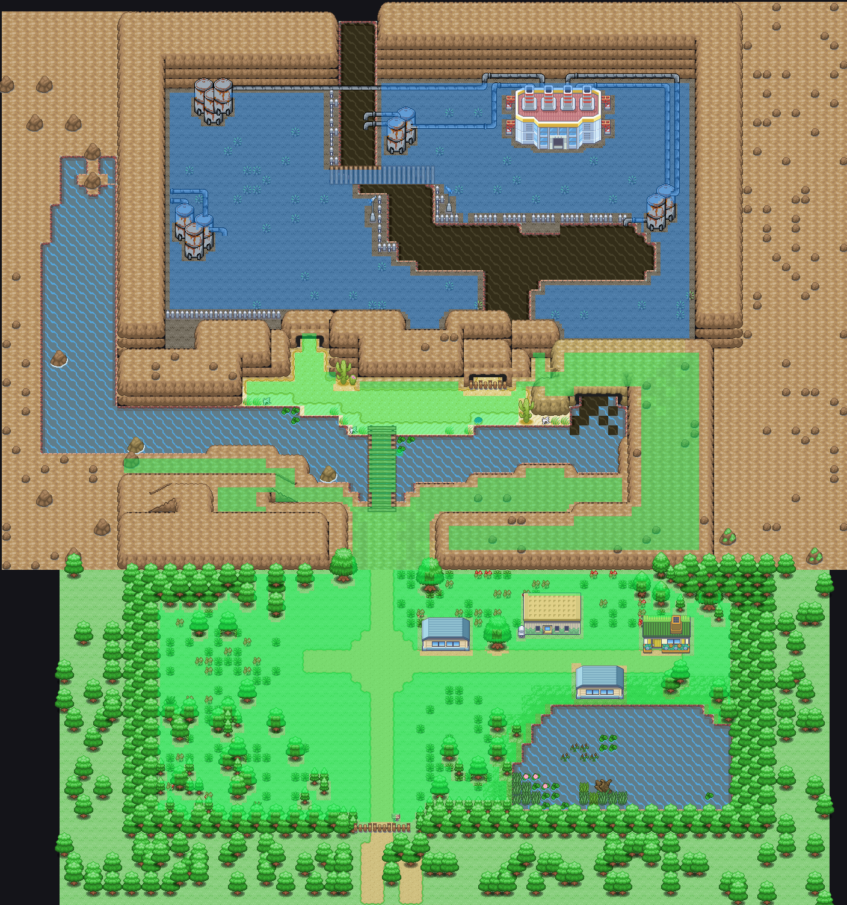

# Implementação: Colisões do mapa, IA e spawn dos inimigos

| Campo | Valor |
| :--- | :--- |
| Data | 2026-11-22 |
| Tipo | `fix` (mapa e inimigos) + `feat` (IA e spawn por zonas) |
| Pendências | B03, B04, B08, B11, B12, B13, F01 |
| Plano | [`planos/2026-11-22-colisoes-mapa-ia-spawn.md`](../planos/2026-11-22-colisoes-mapa-ia-spawn.md) |
| Commit(s) | `818876e` (mapa) · `f31cf54` (inimigo) · `06bf45e` (IA) · `27a82f3` (spawn) |

## O que foi feito

*Verde = cidade e praia. Azul = refinaria, acessada pela caverna.*

### Mapa
- **Escada e ponte de madeira liberadas:** `terreno_colisao.gd` remove, em tempo de execução, só a colisão dos tiles de margem cobertos por elas. A ponte da refinaria tinha o mesmo defeito e dividia a área em duas.
- **Regras únicas de terreno:** `RegrasTerreno` é usada pelo Player e pela navegação dos inimigos.
- **Sem saída do mapa:** célula sem terreno bloqueia, e `LimitesMapa` fecha a subida para os planaltos laterais. A câmera tem limites.
- **Paredes invisíveis removidas:** canos baixos, capim, plantas e areia sobreposta não bloqueiam mais. Isso também conectou o sudeste da refinaria.
- **Objetos altos sólidos:** tanques, turbinas e tocos agora bloqueiam a metade de baixo do desenho. Antes só a célula de origem bloqueava, e dava para atravessar os tanques.
- **Caverna com fade:** a caverna da praia leva a um túnel na refinaria, ida e volta, com o controle travado durante a transição. O túnel usa a arte nova `Assets/levels/entrada_tunel.png`.

### Inimigos
- **Navegação:** `MapaNavegacao` monta uma grade A* de 8 px e separa o mapa em regiões conectadas.
- **Estados:** patrulha, perseguição, aviso + ataque, recuperação e retorno (com recuperação de vida).
- **Combate:** aviso vermelho de 0,25 s antes do golpe, flash ao receber dano e knockback que não empurra para água ou paredes.
- **Correções:** sprite e colisão centralizados, `Camera2D` removido, inimigos na camada física 3 (o jogador não trava neles) e separação entre eles.

### Spawn por zonas

| Zona (nó em `EnemySpawn`) | Máx. simultâneo |
| :--- | :-: |
| Cidade | 0 (sem zona) |
| `ZonaPraia` | 3 |
| `ZonaRefinariaOeste` | 4 |
| `ZonaRefinariaLeste` | 5 |

O inimigo só nasce em ponto livre, conectado ao jogador, a pelo menos 190 px (fora da tela) e em zona próxima do jogador. Depois de uma morte, a reposição leva 6 s.

## Alterações por arquivo

| Arquivo | O que mudou |
| :--- | :--- |
| `Scripts/World/regras_terreno.gd` | **Novo:** regras de caminhabilidade |
| `Scripts/World/terreno_colisao.gd` | **Novo:** libera a física sob escada e ponte |
| `Scripts/World/mapa_navegacao.gd` | **Novo:** grade A* e regiões |
| `Scripts/World/passagem_caverna.gd` | **Novo:** passagem com fade |
| `Scripts/Character/Enemy/zona_spawn.gd` | **Novo:** dados e contagem de cada zona |
| `Scripts/Character/Enemy/enemy_spawn.gd` | Gerencia as zonas |
| `Scripts/Character/Enemy/inimigo.gd` | Reescrito com estados e pathfinding |
| `Scripts/Character/Player/player.gd` | Usa `RegrasTerreno`, `set_travado()`, knockback e golpe saindo do corpo |
| `Scene/town.tscn` | Script do terreno, limites, câmera, zonas, navegação e passagens |
| `Scene/inimigo.tscn` | Centralização, camada física e remoção da câmera |
| `Assets/levels/entrada_tunel.png` | **Novo:** arte do túnel |
| `ferramentas/testes/teste_mapa_headless.gd` | **Novo:** conectividade, limites, tanques, passagens e spawn |
| `ferramentas/testes/teste_combate_headless.gd` | **Novo:** fluxo completo de jogo |

## Verificação (Godot 4.7.1 headless)

| Medida | Antes | Depois |
| :--- | :-: | :-: |
| Cidade alcança a praia | não | **sim** |
| Refinaria em uma só região | não (3 partes) | **sim** |
| Posições alcançáveis fora do mapa | 34.335 | **0** |
| Planaltos laterais acessíveis | sim | **não** |
| Posições de spawn em parede ou isoladas | 97% | **0%** (validadas antes de nascer) |

- `teste_mapa_headless.gd` e `teste_combate_headless.gd`: **PASSOU**, sem nenhum `ERROR`.
- `teste_player_headless.gd`: sem erros e com os mesmos quadros de animação.
- Montagem da grade: ~256 ms, uma vez ao carregar a cidade. Caminho mais longo: ~1 ms.

**Testado e aprovado pelo usuário jogando (2026-11-22).**

## Pontos de atenção

- Os valores de balanceamento são `@export`, ajustáveis no Inspector do inimigo, do `EnemySpawn` e de cada zona.
- As áreas das zonas estão em coordenadas globais.
- Novos tiles de decoração baixa precisam entrar em `DECORACAO_VEGETACAO`, senão bloqueiam.
- Novas pontes sobre água precisam estar na faixa de atlas de `terreno_colisao.gd`.
- O jogador pode andar pelo topo das montanhas a leste da praia. Foi mantido porque é uma área fechada e não leva para fora do mapa.
