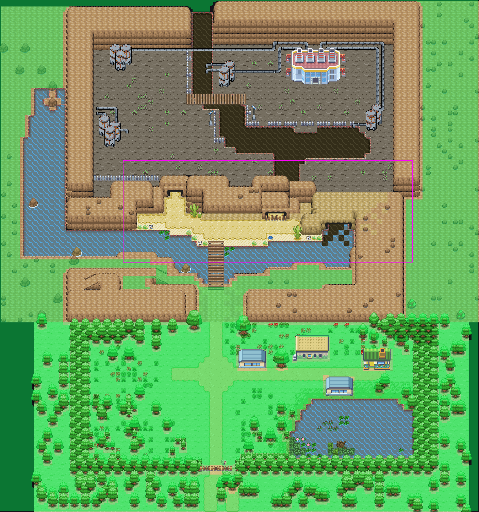

# Plano: Colisões do mapa, IA e spawn dos inimigos

| Campo | Valor |
| :--- | :--- |
| Data | 2026-11-22 |
| Tipo | `fix` (mapa e inimigos) + `feat` (IA e spawn por zonas) |
| Pendências | B03, B04, B08, B11, B12, B13, F01 |
| Status | `Implementado` — testado e aprovado pelo usuário em 2026-11-22 |

## 1. Objetivo

- O jogador consegue atravessar a escada e explorar a parte de cima do mapa.
- O jogador não sai mais do mapa nem anda por áreas que deveriam ser barreira.
- Os inimigos nascem em lugares jogáveis, contornam obstáculos e chegam até o jogador.
- O combate acontece em áreas definidas, com ritmo e pressão controlados.

## 2. Diagnóstico

Medido na Godot 4.7.1 em modo headless, com a caixa de colisão real do Player (14×8) e a regra de terreno do `player.gd`. Nenhum arquivo do jogo foi alterado.



*Verde = onde o jogador consegue chegar hoje. Sem verde = inacessível. Retângulo rosa = área atual de spawn.*

| ID | Problema | Evidência | Causa |
| :-: | :--- | :--- | :--- |
| B11 | **Escada bloqueada** | A região da cidade não alcança a praia | 6 tiles de margem da água, embaixo da escada, têm colisão física (tiles globais x 5–7, nas linhas y -19 e -13). O código libera a ponte, mas a física continua barrando |
| B12 | **Jogador sai do mapa** | 34.335 das 79.588 posições alcançáveis (43%) não têm nenhum tile | Não há limite externo. O jogador também anda pelos planaltos laterais, por fora das montanhas |
| B13 | **Spawn quebrado** | Das 1.026 posições possíveis: **390 em parede (38%)**, **607 em áreas isoladas (59%)** e só **29 alcançáveis (3%)** | Área fixa e sorteada, sem validar o terreno. Além disso, `global_position` é definido antes de o inimigo entrar na cena, o que desloca tudo em (83, 147) |
| B04 | **Inimigo sem inteligência** | Fica preso na primeira parede | Anda em linha reta até o jogador, sem pathfinding |
| B08 | **Alvo e alcance tortos** | Inimigo mede distância a partir do canto do sprite | Sprite e colisão do slime estão deslocados em (8, 8) |
| B03 | **Câmera sobrando** | Cada slime tem um `Camera2D` | Resto de configuração da cena |
| F01 | **Golpe sem impacto** | `apply_knockback()` nunca é chamado | Falta ligar no ataque do Player |

A maior parte das colisões de árvores, casas, água e montanhas está correta e **não será refeita**.

## 3. Solução

### Fase 1: Mapa (`fix`)
1. **Escada:** um script em `tipo_terreno` remove, em tempo de execução, a colisão apenas dos tiles de margem cobertos pelos tiles da escada. O visual não muda, e qualquer ponte igual fica coberta.
2. **Limites:** barreira nas bordas da área jogável e bloqueio da subida para os planaltos laterais.
3. **Câmera:** `limit_*` no `Camera2D`, para nunca mostrar o vazio fora do mapa.
4. **Caverna:** duas áreas de passagem (praia ↔ refinaria) com fade rápido, bloqueio do controle durante a transição e um ponto de chegada livre, afastado da entrada, para não reativar a passagem sozinha.
5. **Varredura:** teste automático que falha se houver área jogável desconectada, jogador no vazio ou passagem mais estreita que o Player.

### Fase 2: Navegação e IA (`fix` + `feat`)
1. **`Scripts/World/mapa_navegacao.gd`:** monta uma grade `AStarGrid2D` de 8 px a partir das mesmas regras de colisão do Player, com folga para o tamanho do inimigo. É a fonte única de "onde dá para andar".
2. **Estados do inimigo:**

| Estado | Comportamento |
| :--- | :--- |
| Patrulha | Anda devagar perto do ponto de origem |
| Perseguição | Viu o jogador (~110 px): segue o caminho A*, recalculado a cada ~0,4 s |
| Ataque | Para, faz um aviso curto (~0,25 s) e golpeia, dando chance de desviar |
| Retorno | Jogador fugiu (~180 px ou longe da zona): volta para casa e recupera a vida |

3. **Separação:** inimigos se afastam levemente uns dos outros, para não virarem uma pilha.
4. **Correções:** centralizar sprite e colisão do slime (B08), remover o `Camera2D` (B03) e aplicar knockback no golpe (F01).

### Fase 3: Spawn por zonas (`feat`)
Cada zona é um nó na cena, ajustável pelo editor, com área, limite de inimigos e intervalo.

- Sorteia apenas pontos caminháveis e conectados ao jogador.
- Nunca nasce dentro da tela (fora de ~180 px do jogador).
- Só ativa zonas próximas ao jogador, evitando inimigos gastando processamento longe.
- Inimigo morto é reposto depois de um intervalo (~6 s), criando ondas em vez de fluxo constante.

| Zona | Máx. simultâneo | Papel |
| :--- | :-: | :--- |
| Cidade | 0 | Área segura |
| Praia | 3 | Primeiro contato |
| Refinaria oeste | 4 | Pressão média |
| Refinaria leste / fábrica | 5 | Área mais difícil |

## 4. Arquivos afetados

| Arquivo | Mudança |
| :--- | :--- |
| `Scene/town.tscn` | Script em `tipo_terreno`, limites, câmera, nó de navegação e zonas |
| `Scene/inimigo.tscn` | Centralizar sprite/colisão e remover `Camera2D` |
| `Scripts/Character/Enemy/inimigo.gd` | Estados, pathfinding, separação e knockback |
| `Scripts/Character/Enemy/enemy_spawn.gd` | Spawn por zonas |
| `Scripts/Character/Player/player.gd` | Chamar `apply_knockback()` |
| `Scripts/World/mapa_navegacao.gd`, `Scripts/World/terreno_colisao.gd`, `Scripts/World/passagem_caverna.gd` | Novos |
| `ferramentas/testes/teste_mapa_headless.gd` | Novo: conectividade, limites e qualidade do spawn |

## 5. Riscos

- **`town.tscn` é grande:** as edições ficam restritas a nós e propriedades, sem tocar nos dados dos tiles.
- **Balanceamento:** os valores são iniciais e ficam como `@export`, para ajuste fino depois de jogar.
- **Refinaria:** a praia não se conecta a pé à refinaria, por isso a passagem é pela caverna. O lado leste da refinaria ainda precisa ter a conexão confirmada pelo teste de mapa; se estiver isolado, o ajuste entra na Fase 1.

## 6. Como testar

**Automático:** teste de mapa + `teste_player_headless.gd`, sem nenhum `ERROR`.

**Jogando:**
1. Subir e descer a escada, encostando nas laterais.
2. Tentar sair do mapa pelas bordas.
3. Entrar na praia: os inimigos devem aparecer fora da tela e contornar pedras até você. Depois, ir e voltar pela caverna até a refinaria.
4. Fugir: eles devem desistir e voltar.
5. Lutar: conferir aviso do ataque, knockback e reposição.
6. Voltar à cidade: nenhum inimigo deve nascer ali.

## 7. Commits previstos

```
fix(mapa): libera a escada e fecha os limites jogáveis
fix(enemy): corrige origem, câmera e knockback do inimigo
feat(enemy): adiciona navegação e estados de IA aos inimigos
feat(spawn): adiciona spawn de inimigos por zonas de combate
chore(contexto): documenta colisões, IA e spawn
```

## 8. Validação do usuário

- [x] Plano aprovado pelo usuário (2026-11-22)
- **Decisão 1, acesso à refinaria (decidido em 2026-11-22):** **caverna com fade**. A caverna superior esquerda da praia vira uma passagem de ida e volta até a refinaria, com fade rápido, sem editar tiles. Inimigos não atravessam a passagem.
- **Decisão 2, cidade (decidido em 2026-11-22):** área segura, sem inimigos.
- Observações/ajustes pedidos:
