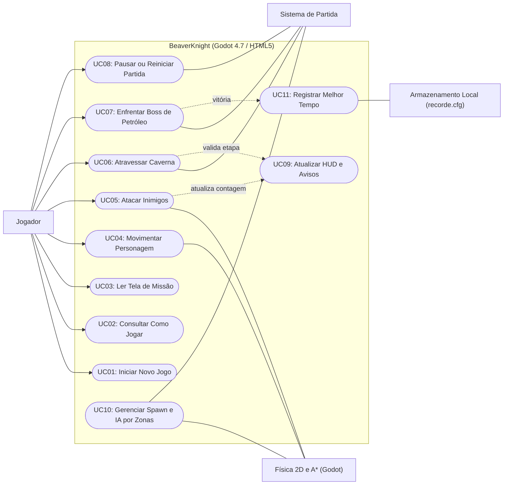
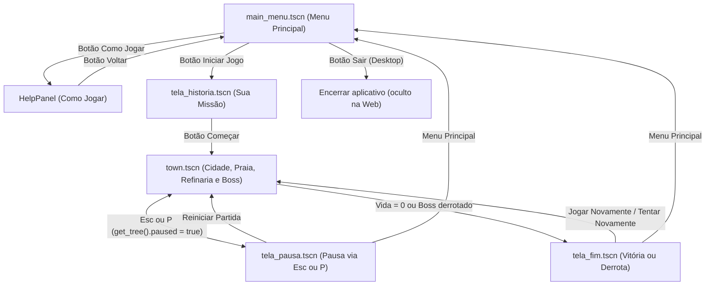
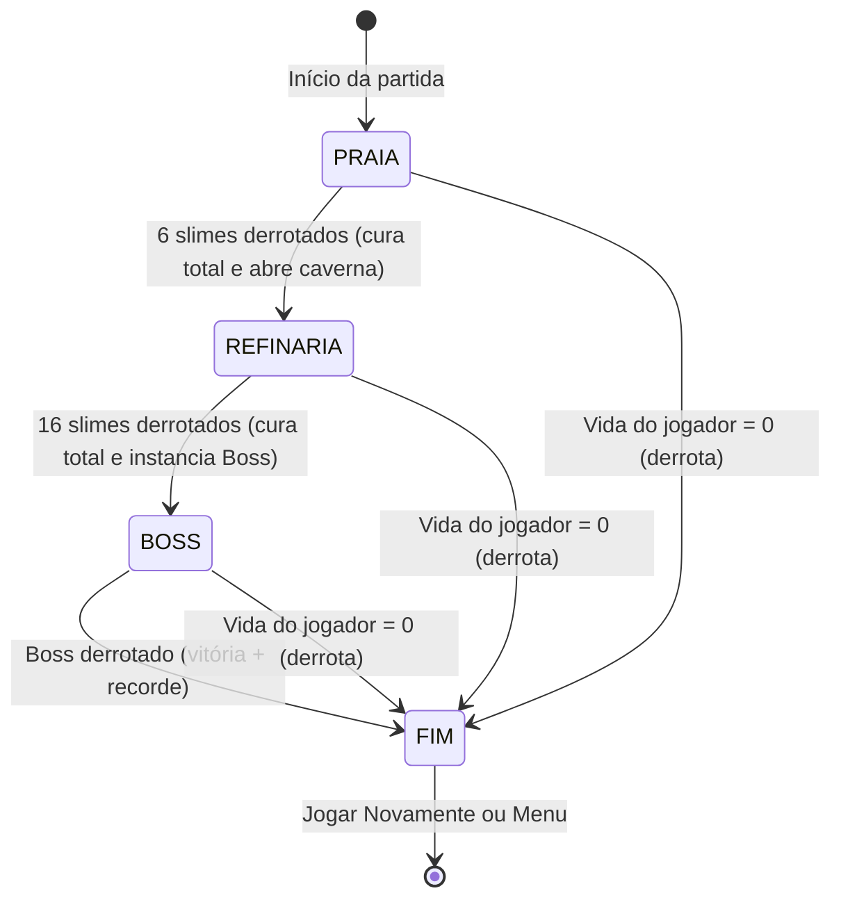
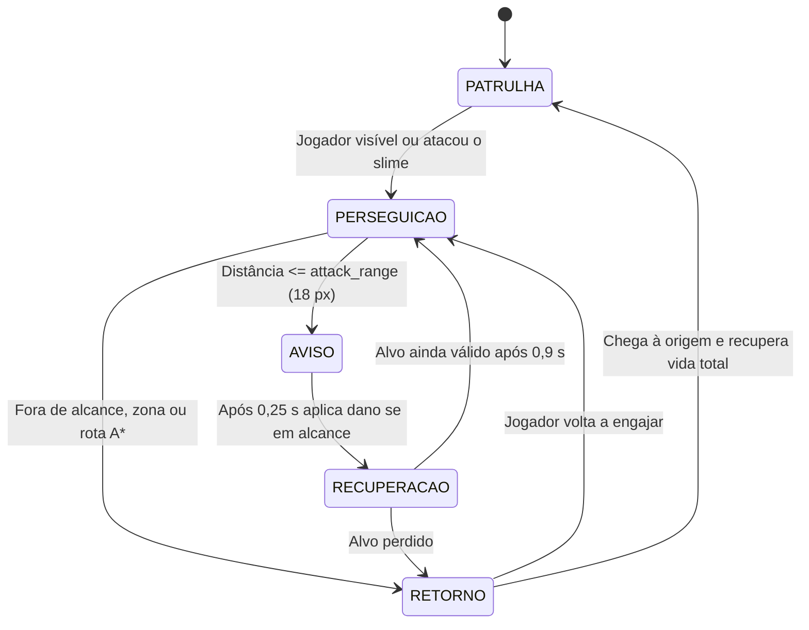
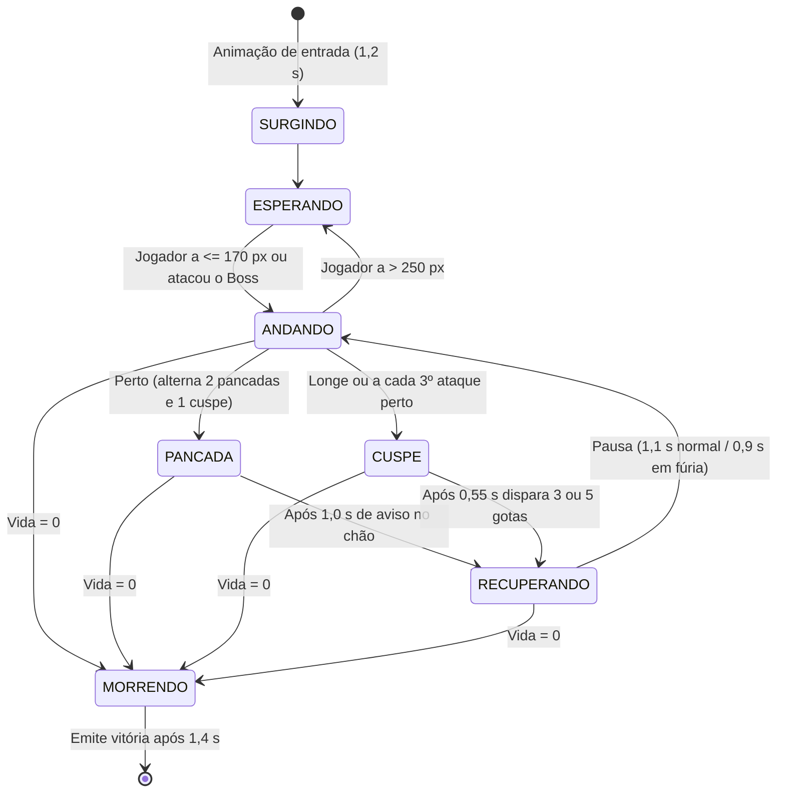

# Fluxo do Jogo e Casos de Uso: BeaverKnight

| Campo | Informação |
| :--- | :--- |
| Projeto | BeaverKnight: Sustentabilidade em 8-Bits |
| Escopo | Casos de uso reais, navegação entre telas e estados de jogo |
| Referência técnica | `beaver-knight-app/Scene/` e `beaver-knight-app/Scripts/` |

## 1. Casos de uso

### 1.1 Atores e fronteira do sistema

O sistema atende um ator principal (Jogador) e interage com três componentes internos como atores secundários: o Sistema de Partida (`Partida`), o módulo de Navegação e Física Godot (`RegrasTerreno`, `MapaNavegacao` e `CharacterBody2D`) e o Armazenamento Local (`user://recorde.cfg` no computador ou navegador). A fronteira do sistema corresponde ao aplicativo BeaverKnight nas versões Web/HTML5 e desktop em Godot 4.7.

### 1.2 Diagrama de casos de uso

### 1.3 Tabela de casos de uso

| Código | Ator principal | Caso de uso | Descrição | Atores secundários / Relações |
| :-: | :--- | :--- | :--- | :--- |
| UC01 | Jogador | Iniciar Novo Jogo | Seleciona Iniciar Jogo no menu principal para abrir o resumo da missão e começar uma partida limpa | Sistema de Partida |
| UC02 | Jogador | Consultar Como Jogar | Abre o painel `HelpPanel` no menu principal para visualizar etapas, controles e regra de derrota | Interface (`main_menu.gd`) |
| UC03 | Jogador | Ler Tela de Missão | Visualiza objetivo, sequência das três áreas e teclas na cena `tela_historia.tscn` antes de entrar na cidade | Interface (`tela_historia.gd`) |
| UC04 | Jogador | Movimentar Personagem | Move o Cavaleiro Castor em 8 direções pelas áreas caminháveis respeitando rios, petróleo, escada, pontes e objetos altos | Física 2D e `RegrasTerreno` |
| UC05 | Jogador | Atacar Inimigos | Aciona o golpe de espada em cone frontal para causar dano e empurrar slimes ou o chefe final | Física 2D e Sistema de Partida |
| UC06 | Jogador | Atravessar Caverna | Entra na caverna da praia (liberada após 6 slimes) ou no túnel da refinaria para alternar entre as duas regiões com transição em fade | Sistema de Partida (`PassagemCaverna`) |
| UC07 | Jogador | Enfrentar Boss de Petróleo | Combate o chefe no pátio da fábrica desviando das pancadas em área e dos projéteis de cuspe até zerar sua vida | Sistema de Partida e Física 2D |
| UC08 | Jogador | Pausar ou Reiniciar Partida | Pressiona `Esc` ou `P` durante a partida para congelar a cena e escolher Continuar, Reiniciar Partida ou Menu Principal | Sistema de Partida (`TelaPausa`) |
| UC09 | Sistema de Partida | Atualizar HUD e Avisos | Atualiza barra de vida, contador de meta da etapa, avisos temporários de transição/fúria e barra do Boss | Interface (`HUD`) |
| UC10 | Sistema de Partida | Gerenciar Spawn e IA por Zonas | Gera slimes fora da tela dentro da zona ativa (`ZonaPraia` ou `ZonaRefinaria`) e controla patrulha, rota A*, aviso e ataque | Física 2D e `MapaNavegacao` |
| UC11 | Sistema de Partida | Registrar Melhor Tempo | Grava e compara o menor tempo de vitória localmente ao concluir o confronto contra o Boss | Armazenamento Local (`user://recorde.cfg`) |

## 2. Fluxo entre telas e cenas

### 2.1 Diagrama de navegação

### 2.2 Comportamento detalhado das telas

| Tela / Cena | Comportamento na execução |
| :--- | :--- |
| Menu Principal (`Scene/main_menu.tscn`) | Inicia a música de menu via `AudioManager.play_music()`. Na versão Web (`OS.has_feature("web")`), oculta o botão Sair do Jogo porque o navegador não permite fechar a aba por código. |
| Painel Como Jogar (`HelpPanel`) | Oculta os botões principais do menu e exibe as três etapas, controles (setas, clique esquerdo, `Esc`/`P`) e a regra de reinício em caso de derrota. |
| Tela de Missão (`Scene/tela_historia.tscn`) | Apresenta o resumo da missão antes do combate e carrega `town.tscn` ao acionar Começar. |
| Gameplay (`Scene/town.tscn`) | Carrega o mapa completo, a música de combate, o nó `Player`, `MapaNavegacao`, `EnemySpawn`, `HUD` (`layer = 10`) e `TelaPausa` (`layer = 30`). |
| Pausa (`Scene/tela_pausa.tscn`) | Usa `get_tree().paused = true` com `PROCESS_MODE_ALWAYS` na própria tela e no `AudioManager`, mantendo áudio e botões ativos. Fica bloqueada na passagem da caverna (`travado`), na morte (`morto`) e no fim da partida (`Etapa.FIM`). |
| Tela Final (`Scene/tela_fim.tscn`) | Sobrepõe o jogo pausado (`layer = 40`) exibindo resultado (`PARABÉNS, CAVALEIRO!` ou `A POLUIÇÃO VENCEU...`), tempo total, inimigos derrotados, melhor tempo e ações de reiniciar (`reload_current_scene()`) ou voltar ao menu. |

## 3. Ciclo da partida e máquinas de estado

### 3.1 Etapas da partida (`Partida`)

### 3.2 Estados da IA do Death Slime (`inimigo.gd`)

### 3.3 Estados do Boss de Petróleo (`boss_petroleo.gd`)

## 4. Interações do jogador e feedbacks

| Interação | Entrada | Ação no motor | Feedback visual e sonoro |
| :--- | :--- | :--- | :--- |
| Movimentação | Setas direcionais ou D-Pad | Move `CharacterBody2D` a `100 px/s` testando `RegrasTerreno` separadamente em X e Y para deslizar nas margens | Animação `walk_*` no `AnimationTree` e som de passo (`sfx_grass_2.wav`) sincronizado nos quadros de pisada |
| Ataque corpo a corpo | Botão esquerdo do mouse | Trava movimento por até `0,5 s`; no quadro de impacto (`aplicar_golpe`) testa distância colada (`12 px`) ou cone frontal (`28 px`) | Animação `attack_armed_*` com rastro da espada, som `Som-espada.wav`, flash branco e recuo no slime, tremida leve na câmera |
| Passagem pela caverna | Colisão com `Area2D` da caverna | Checa se `Partida.etapa >= 1`; se liberada, teleporta para a refinaria (ou volta à praia) | Fade preto de entrada e saída (`0,2 s`), aviso na HUD caso a praia ainda não esteja limpa |
| Receber dano | Ataque do slime, pancada ou gota do boss | Reduz `current_health`, aplica recuo e ativa `0,7 s` de invencibilidade | Sprite pisca em transparência, câmera treme, barra de vida reduz e som `Som-Dano.mp3` toca |
| Pausa | `Esc` ou `P` | Alterna `get_tree().paused` e visibilidade da `TelaPausa` | Painel escuro centralizado com botões Continuar, Reiniciar Partida e Menu Principal |
