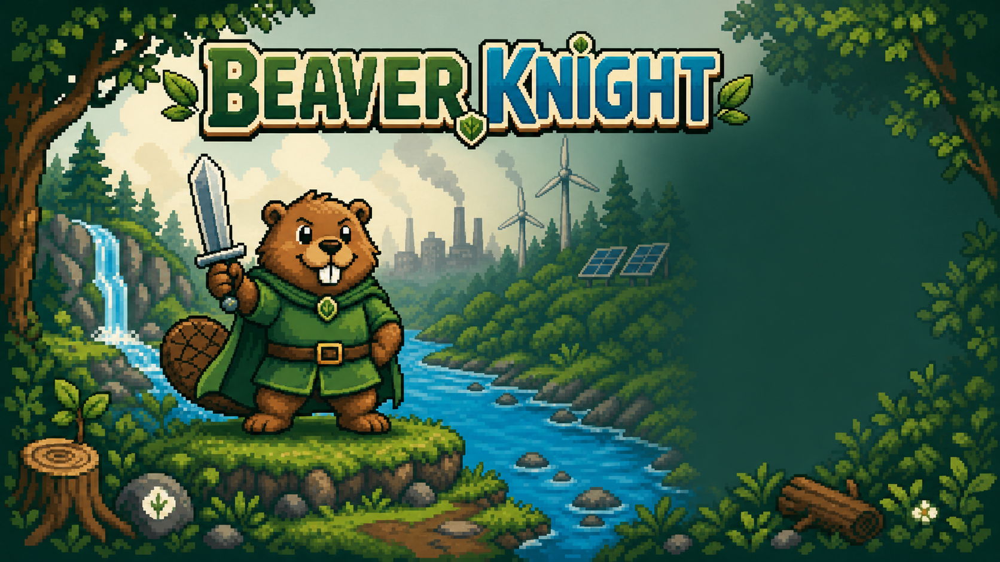
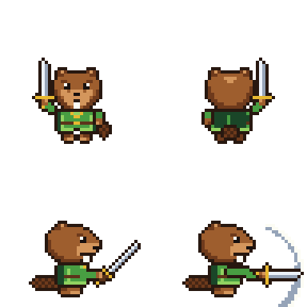
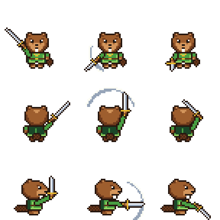
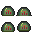
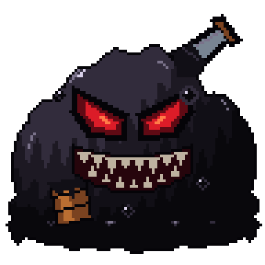
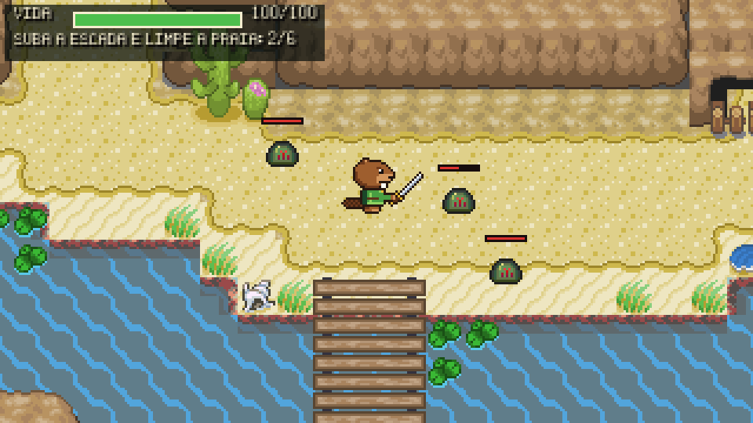
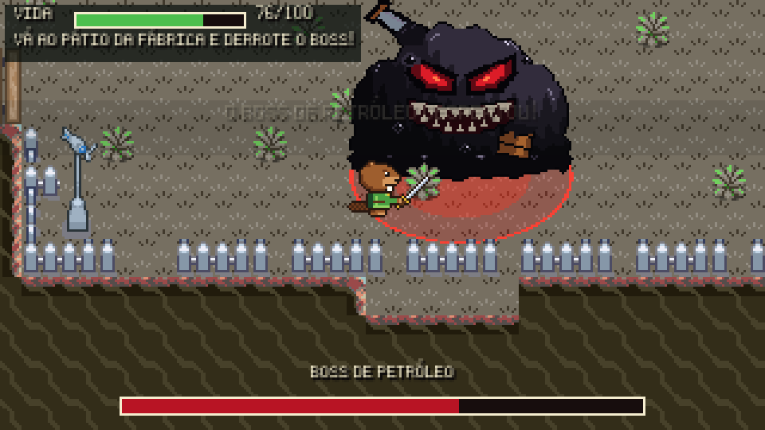
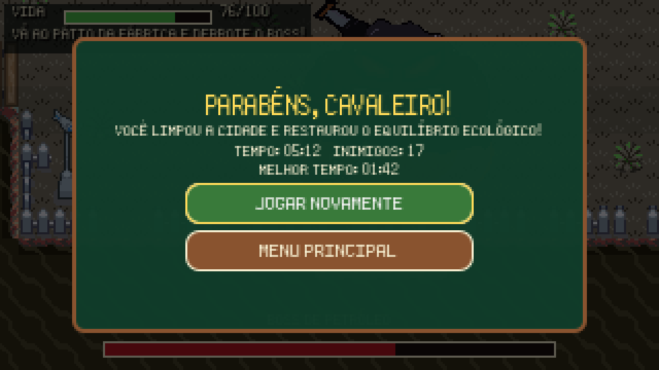

# Game Design Document (GDD): BeaverKnight

| Campo | Informação |
| :--- | :--- |
| Título | BeaverKnight: Sustentabilidade em 8-Bits |
| Gênero | Ação e aventura top-down 2D |
| Motor e linguagem | Godot Engine 4.7 (GL Compatibility) e GDScript |
| Público principal | Estudantes de 11 a 17 anos (Ensino Fundamental II e Médio) e educadores |
| Plataforma | Web/HTML5 (GitHub Pages) e Desktop |
| Duração da partida | 5 a 8 minutos |

## 1. Visão geral do projeto

### 1.1 Resumo executivo

BeaverKnight é um jogo educativo 2D em Pixel Art desenvolvido como Projeto de Extensão Universitária no curso de Ciência da Computação da UniFil. O jogador controla o Cavaleiro Castor e percorre uma região afetada pela poluição para derrotar slimes tóxicos na praia, atravessar a caverna até a refinaria poluída e vencer o Boss de Petróleo no pátio da fábrica.

O projeto roda diretamente no navegador sem instalação nem dependência de servidores externos, permitindo uso imediato em laboratórios escolares e oficinas educativas.

### 1.2 Alinhamento pedagógico e ODS

O mapa traduz problemas ambientais em contrastes visuais diretos: rios de água limpa dividem espaço com canais contaminados por óleo, tanques industriais enferrujados e tubulações que cercam a refinaria ao norte da cidade. Essa construção dialoga com três Objetivos de Desenvolvimento Sustentável (ODS) da ONU: o ODS 7 (Energia Limpa e Acessível), ao contrapor o impacto da refinaria às turbinas eólicas e painéis solares exibidos na arte do menu inicial; o ODS 12 (Consumo e Produção Responsáveis), ao destacar os efeitos do descarte industrial sem controle; e o ODS 15 (Vida Terrestre), ao ligar a derrota das criaturas tóxicas à proteção da fauna e da água da região.

### 1.3 Ficha técnica e restrições

| Item | Configuração real |
| :--- | :--- |
| Resolução base | `320×180 px` ampliada para janela `1280×720 px` (`stretch/mode = canvas_items`) |
| Renderização pixel art | Filtro `Nearest` (`default_texture_filter = 0`) e `snap_2d_transforms_to_pixel = true` |
| Grade do mundo | Tiles de `16×16 px`; grade de navegação A* em células de `8×8 px` |
| Infraestrutura | 100% client-side, sem backend; recorde salvo localmente em `user://recorde.cfg` |
| Build Web | Exportação HTML5 sem threads (`docs/jogo/`), compatível com GitHub Pages |

## 2. Narrativa e ambientação

O conflito parte do avanço da poluição industrial sobre os arredores de uma cidade ribeirinha. O núcleo urbano ainda preserva estradas de terra, árvores e água limpa, mas a faixa de praia sofre com a invasão de slimes tóxicos e a região ao norte abriga uma refinaria cercada por tanques, tubulações e rios de petróleo.

Para manter o ritmo direto em partidas curtas, não há árvores de diálogo. A história aparece na tela inicial de missão (`Sua Missão`) e nos avisos temporários exibidos na HUD quando a caverna abre ou quando o chefe desperta.

## 3. Entidades e personagens

### 3.1 Personagem controlável: Cavaleiro Castor

Implementado como `CharacterBody2D` dentro da cena `town.tscn` (script `Scripts/Character/Player/player.gd`), o protagonista recebeu um sprite sheet exclusivo em estilo GBA (`Sprites/beaver_knight/beaver_knight_sheet.png`, `192×432 px`, grade `4×9` de `48×48 px`, gerado por `ferramentas/sprites/gerar_beaver_knight.js`). O castor veste túnica e capa verdes com cinto e broche dourados, tem cauda quadriculada, dentões característicos e empunha a espada em todas as poses.

| Parâmetro | Valor no jogo |
| :--- | :--- |
| Vida máxima (`max_health`) | `100` |
| Velocidade de caminhada (`walk_speed`) | `100 px/s` (8 direções normalizadas) |
| Dano da espada (`attack_damage`) | `25` |
| Alcance do golpe | `12 px` colado em qualquer ângulo ou `28 px` no cone frontal (`dot > 0,3`, ~140°) |
| Força de knockback aplicado (`forca_knockback`) | `190 px/s` |
| Invencibilidade pós-dano (`tempo_invencivel`) | `0,7 s` com piscar de transparência |
| Recuo ao receber dano (`forca_recuo`) | `150 px/s` |
| Origem e colisão | Origem nos pés `(24, 44)`; caixa de colisão `14×8 px` em `(0, -4)` |

As animações rodam em uma `AnimationTree` (`AnimationNodeStateMachine`) com três estados em `BlendSpace2D`: `idle` (quadros 0 e 1, 4 e 5, 8 e 9), `walk` (quadros 12 a 15, 16 a 19, 20 a 23) e `attack_armed` (quadros 24 a 27, 28 a 31, 32 a 35). A direção esquerda espelha as animações da direita via `flip_h = true`. O dano ocorre exatamente no quadro de impacto (`aplicar_golpe`) e uma trava de `0,5 s` impede que o personagem fique preso caso o ataque seja interrompido.

### 3.2 Inimigo comum: Death Slime

Os inimigos comuns (`Scene/inimigo.tscn`, script `Scripts/Character/Enemy/inimigo.gd`) usam o sprite `DeathSlime.png` (grade `2×2`), colisão `12×12 px` na camada física 3 (sem empurrar ou travar o jogador) e exibem uma barra de vida individual (`BarraVida`) acima da cabeça.

| Parâmetro | Valor no jogo |
| :--- | :--- |
| Vida máxima (`max_health`) | `50` (2 golpes do castor) |
| Velocidade de perseguição (`move_speed`) | `62 px/s` |
| Velocidade de patrulha (`velocidade_patrulha`) | `26 px/s` (raio `48 px`) |
| Raio de visão / perda (`raio_visao` / `raio_perda`) | `110 px` / `180 px` |
| Dano e alcance (`attack_damage` / `attack_range`) | `10` / `18 px` |
| Tempo de aviso (`tempo_aviso`) | `0,25 s` (sprite fica avermelhado antes do golpe) |
| Recarga entre ataques (`attack_cooldown`) | `0,9 s` |

A inteligência artificial opera com cinco estados: `PATRULHA`, `PERSEGUICAO`, `AVISO`, `RECUPERACAO` e `RETORNO`. Em perseguição e retorno, o slime calcula rotas com `AStarGrid2D` (`MapaNavegacao`) contornando rios, paredes e tanques. Quando vários slimes se aproximam, uma força de separação evita que se empilhem no mesmo pixel. Ao receber golpe do castor, o knockback verifica antes se o destino está livre para impedir que o inimigo seja jogado na água ou dentro de obstáculos.

### 3.3 Chefe final: Boss de Petróleo

O chefe final (`Scene/boss_petroleo.tscn`, script `Scripts/Character/Enemy/boss_petroleo.gd`) nasceu de um design original baseado na arte conceitual de petróleo do projeto (`Sprites/boss/boss_petroleo_sheet.png`, `576×576 px`, folha `6×6` de `96×96 px`, gerada por `ferramentas/sprites/gerar_boss_petroleo.js`). É uma massa gigante de óleo escuro com olhos vermelhos, dentes irregulares, cano metálico e barril enferrujado presos ao corpo.

| Atributo | Estado normal | Em fúria (≤ 50% de vida) |
| :--- | :--- | :--- |
| Vida máxima (`max_health`) | `1050` (42 golpes) | `≤ 525` |
| Velocidade de movimento | `34 px/s` | `44 px/s` |
| Pancada em área (`dano_pancada`) | `27` de dano, raio `46 px`, aviso de `1,0 s` | Mesmo dano e aviso |
| Cuspe de petróleo (`dano_cuspe`) | `3` gotas (abertura 16°), `7` de dano cada, aviso `0,55 s` | `5` gotas (abertura 16°), `7` de dano cada |
| Recuperação pós-ataque | `1,1 s` | `0,9 s` |
| Intervalo entre ataques | `1,4 s` | `1,05 s` |
| Efeito de transição para fúria | Sem efeito adicional | Cura `+35` de vida no jogador e exibe aviso na HUD |

O Boss desperta quando o jogador se aproxima a `170 px` dentro do pátio da fábrica (`arena = Rect2(225, -770, 305, 95)`). De perto, alterna duas pancadas em área e um cuspe; de longe, ataca com cuspes direcionados (`projetil_petroleo.gd`, velocidade `85 px/s`). Toda pancada desenha um círculo vermelho crescente no chão durante `1,0 s`, dando janela clara para o jogador sair da área e contra-atacar durante a recuperação. Encostar no corpo do chefe não causa dano direto.

## 4. Gameplay, progressão e level design

### 4.1 Ciclo principal (Core Loop)

O loop de gameplay combina exploração de mapa, leitura de terreno e combate reativo em três etapas sequenciais:

1. Sair da cidade segura e localizar os inimigos na zona ativa.
2. Golpear os slimes no alcance frontal aproveitando o knockback e evitando o momento em que ficam vermelhos para atacar.
3. Ao bater a meta de inimigos da etapa, recuperar a vida total (`100/100`) e avançar para a área seguinte até o confronto com o chefe.

### 4.2 Estrutura do mapa (`Scene/town.tscn`)

Toda a aventura se passa em um único cenário dividido por barreiras naturais e passagens, organizado em quatro `TileMapLayer`. A camada `tipo_terreno` define solo caminhável (`source_id = 5`), água limpa animada e rios de petróleo (`DirtyWaterTexture.tres`). A camada `caminho_terreno` contém estradas, escadas e pontes de madeira que liberam travessia sobre água e óleo. Por cima delas ficam `vegetação_layer` (árvores, arbustos, cactos, capim e flores) e `construções_layer` (casas, cercas, canos e tanques industriais).

| Área | Etapa | Slimes na partida | Simultâneos | Comportamento do spawn (`ZonaSpawn`) |
| :--- | :--- | :-: | :-: | :--- |
| Cidade | Área segura | `0` | `0` | Ponto inicial do jogador (`(31, 58)`), sem inimigos |
| Praia | Etapa 1 (`PRAIA`) | `6` | até `3` | Nascem distribuídos na praia fora da tela (`≥ 190 px`), intervalo de `2,0 s` (reposição `3,0 s`) |
| Refinaria | Etapa 2 (`REFINARIA`) | `16` | até `5` | Nascem em anel próximo (`190 a 280 px`, caminho `≤ 460 px`) e caçam o jogador via A* (`1,5 s` de intervalo) |
| Pátio da fábrica | Etapa 3 (`BOSS`) | `1` chefe | `1` | Boss de Petróleo surge em `(400, -720)` ao fim da etapa anterior |

A passagem entre a praia e a refinaria ocorre pela caverna (`PassagemCaverna`). Antes de derrotar os 6 slimes da praia, entrar na caverna exibe o aviso `"LIMPE A PRAIA PARA ABRIR A CAVERNA!"`. Quando a etapa é concluída, a caverna e o túnel da refinaria passam a transportar o jogador em mão dupla com efeito de fade de `0,2 s`, travando o controle durante a transição.

## 5. Regras do jogo e física

### 5.1 Caminhabilidade e colisão (`RegrasTerreno`)

O arquivo `Scripts/World/regras_terreno.gd` centraliza as regras de movimentação compartilhadas entre jogador e navegação dos inimigos. Células sem tile em `tipo_terreno` bloqueiam a passagem, impedindo saída do mapa, enquanto qualquer tile em `caminho_terreno` libera o movimento sobre rios ou petróleo. Decorações baixas listadas em `DECORACAO_VEGETACAO` e canos baixos no chão permitem passagem sem criar paredes invisíveis; já estruturas altas de várias células (árvores, tocos, tanques e turbinas) bloqueiam apenas a metade inferior do desenho para que o castor passe por trás do topo.

Em complemento, `terreno_colisao.gd` remove em tempo de execução a física de margem sob a escada da praia e a ponte da refinaria, `LimitesMapa` fecha os planaltos laterais e a `Camera2D` respeita limites fixos (`left -429`, `top -1024`, `right 852`, `bottom 480`).

### 5.2 Vitória, derrota e recorde

Derrotar o Boss de Petróleo aciona a tela de vitória (`PARABÉNS, CAVALEIRO!`), enquanto zerar a vida (`0/100`) encerra imediatamente a partida na tela de derrota (`A POLUIÇÃO VENCEU...`), sem checkpoints intermediários.

A tela final (`tela_fim.gd`) apresenta tempo decorrido (`MM:SS`), total de inimigos derrotados (slimes e boss) e melhor tempo de vitória salvo em `user://recorde.cfg`. O botão Jogar Novamente recarrega a cena e reinicia todos os contadores.

## 6. Interface e controles

### 6.1 Telas do jogo

| Tela / Cena | Função e elementos exibidos |
| :--- | :--- |
| Menu Principal (`main_menu.tscn`) | Fundo ilustrado (`BeaverKnight-BG.png`), moldura de folhas e botões Iniciar Jogo, Como Jogar (painel `HelpPanel`) e Sair do Jogo (oculto na Web) |
| Sua Missão (`tela_historia.tscn`) | Resumo da história, lista das três etapas e controles antes de carregar a cidade |
| HUD (`hud.gd`) | Barra de vida verde (fica vermelha em `≤ 30%`), texto numérico (`100/100`), objetivo da etapa atual, faixa central de avisos e barra inferior do Boss de Petróleo |
| Tela de Pausa (`tela_pausa.gd`) | Acionada por `Esc` ou `P`, pausa a árvore de cena e oferece Continuar, Reiniciar Partida e Menu Principal (bloqueada na caverna, na morte e no fim) |
| Tela Final (`tela_fim.gd`) | Resultado da partida, tempo, inimigos derrotados, melhor tempo e botões Jogar Novamente / Menu Principal |

### 6.2 Mapeamento de controles (`project.godot`)

| Entrada | Ação no jogo | Observação |
| :--- | :--- | :--- |
| Setas direcionais (`←` `↑` `↓` `→`) ou D-Pad | Movimentar em 8 direções | Ações `ui_left`, `ui_right`, `ui_up`, `ui_down` |
| Botão esquerdo do mouse | Atacar com a espada | Ação `attack` (trava o passo durante o golpe) |
| `Esc` ou `P` | Abrir/fechar tela de pausa | Ação `pausar`; em tela cheia no navegador, `P` evita sair do modo tela cheia |

## 7. Estética visual e arquitetura sonora

### 7.1 Direção de arte

O projeto adota Pixel Art em baixa resolução (`320×180 px`) com paleta contrastante entre biomas saudáveis e zonas industriais. A água limpa (`WaterTexture.tres`) e o petróleo (`DirtyWaterTexture.tres`) usam `AnimatedTexture` de 8 quadros. A fonte pixelada (`Assets/UI/pkmnfl.ttf`) e os painéis verdes com borda amadeirada de `EstiloUI` unificam menu, missão, pausa, HUD e tela final.

Como o modo `canvas_items` renderiza fontes na resolução real da janela, o script `player.gd` alinha a câmera local ao arredondamento de pixel do sprite após cada `move_and_slide()`, mantendo as letras nítidas sem causar tremor no personagem.

### 7.2 Áudio (`AudioManager`)

O singleton `AudioManager` (`Scripts/World/audio_manager.gd`) roda com `PROCESS_MODE_ALWAYS` para manter músicas e sons de botão funcionando mesmo na pausa e na tela final. A mixagem usa três barramentos em `Sounds/Bus_DeControle.tres`: `Master`, `Music` (`-8,55 dB`) e `Effect` (`-10,61 dB`).

| Recurso | Uso no jogo | Canal / Barramento |
| :--- | :--- | :--- |
| `Som-musicaMenu.mp3` | Música da tela inicial e de missão | `Music` (1 player global) |
| `Som-musicaCombate.mp3` | Música contínua da cidade, praia, refinaria e boss | `Music` (1 player global) |
| `Som-espada.wav` | Ataque do jogador | `Effect` (pool de 8 `AudioStreamPlayer`) |
| `sfx_grass_2.wav` | Passos sincronizados nas animações `walk_*` | `Effect` (pool global com variação de pitch) |
| `Som-Dano.mp3` / `Som-Respawn.mp3` | Dano no jogador e reinício de posição | `Effect` (pool global) |
| `Som-Botão.wav` | Cliques de botões nos menus e modais | `Effect` (pool global) |
| `Som-inimigoMorto.wav` | Morte dos slimes e impactos do Boss de Petróleo | `Effect` (pool de 8 `AudioStreamPlayer2D`) |

Quando o jogo roda no navegador (`OS.has_feature("web")`), o `AudioManager` aplica um reforço automático de `+14 dB` em `Music` e `+8 dB` em `Effect` para compensar a atenuação padrão do áudio Web sem alterar o volume da versão desktop.
